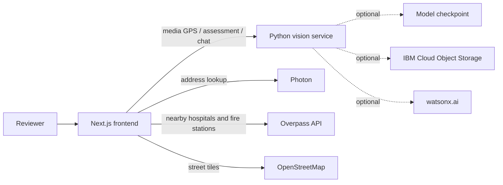

# HazardWatch architecture

HazardWatch has a Next.js frontend and an optional Python vision service. The frontend owns the report workflow and browser session state. The vision service extracts media GPS, runs the assessment model, and generates assistant responses.

## Frontend

The app entry point is `frontend/src/app/page.tsx`. It renders `HazardWorkspace`, which coordinates the Overview, Map, Reports, and Assistant screens. Report state, approvals, selected map items, media previews, and conversation history are held in React state for the current browser session; there is no report database.

The feature code is under `frontend/src/features/hazardwatch/`:

- `components/ImageUpload.tsx` collects media and context, requests GPS metadata, and starts image/video assessment.
- `components/LocationInput.tsx` handles confirmed GPS, address/place selection, manual coordinates, and device location.
- `components/HazardWorkspace.tsx` connects report review, map approval, nearby services, and assistant conversation.
- `components/HazardMap.tsx` wraps Leaflet, map layers, filters, markers, and selected-report details.
- `api.ts`, `location.ts`, `model.ts`, and `emergency-services.ts` validate service data and convert it for the interface.

Next.js route handlers provide browser-facing lookups:

| Route | Purpose | Upstream |
| --- | --- | --- |
| `POST /api/geocode` | Search a typed address and return selectable address candidates | Photon, configurable with `PHOTON_API_URL` |
| `POST /api/emergency-services` | Find nearby hospitals and fire stations for confirmed coordinates | Overpass API |

The map loads OpenStreetMap tiles for its visible area. Bundled Natural Earth geography and local place data provide map outlines and place suggestions; they do not supply live incident data.

## Vision service

`vision-service/app/main.py` exposes the FastAPI service:

| Route | Purpose | Loads model? |
| --- | --- | --- |
| `GET /health` | Service and model/storage status | No |
| `POST /v1/media/location` | Extract supported image/video GPS metadata | No |
| `POST /v1/assess/image` | Classify an uploaded image and return assessment evidence | Yes |
| `POST /v1/assess/video` | Sample and classify an uploaded video | Yes |
| `POST /v1/chat` | Answer a question using the supplied approved report context | No |

The image/video routes use the checkpoint resolved from `MODEL_PATH` or the documented local paths. If no local checkpoint exists, the service can retrieve one from IBM Cloud Object Storage when configured. Watsonx is optional for chat; the service also contains a local fallback. Object storage can optionally retain uploaded media, but the frontend does not save report details or approval state there.

## Report lifecycle

1. The browser submits media to the vision service for GPS extraction or assessment. Location extraction does not load the model. Assessment requires a usable model checkpoint.
2. The reviewer confirms a location and checks the assessment. Failed lookups and unsupported metadata leave manual location options available.
3. The browser creates a pending report in session state. It is not visible as an approved map incident yet.
4. The reviewer approves the report for the workspace map. The map and priority queue use the report's confirmed coordinates and assessment data.
5. The assistant receives the approved reports and conversation history with each chat request. Reloading the page clears that context.

## Configuration and external services

- `NEXT_PUBLIC_VISION_API_URL` sets the frontend's vision-service base URL; it defaults to `http://localhost:8000`.
- `PHOTON_API_URL` optionally selects a Photon-compatible address endpoint.
- `COS_ENDPOINT`, `COS_API_KEY_ID`, `COS_INSTANCE_CRN`, and `COS_BUCKET_NAME` enable checkpoint and media storage.
- `WATSONX_AI_URL`, `WATSONX_AI_APIKEY`, and `WATSONX_AI_PROJECT_ID` configure the optional hosted chat model.

Values in `NEXT_PUBLIC_*` variables are bundled into the browser app. Keep cloud credentials in server-side environment settings. See [`.env.example`](../.env.example) for the variable names and [the IBM Cloud deployment guide](IBM-CLOUD-DEPLOYMENT.md) for deployment steps.

## Operational boundaries

The map, public geocoding, and public emergency-services data are informational and can be incomplete. The model provides an assessment for human review, not a verified fire report. Approval only changes the current workspace view; it does not authorize or initiate a response. The app does not provide live fire boundaries, dispatch, or validated evacuation routing.
